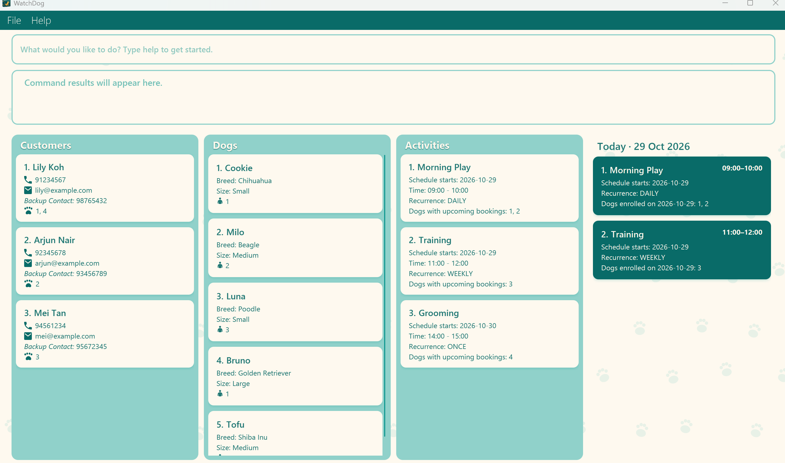

# WatchDog User Guide

WatchDog is a **desktop application for managing dog daycare customers and dogs, optimized for use through a Command Line Interface (CLI)** while retaining the benefits of a Graphical User Interface (GUI). If you type quickly, WatchDog can help you manage daycare records faster than traditional GUI applications.

<!-- * Table of Contents -->
<page-nav-print />

--------------------------------------------------------------------------------------------------------------------

## Quick start

1. Ensure that Java `25` or later is installed on your computer. 
   **Mac users:** Ensure you have the precise JDK version prescribed [here](https://se-education.org/guides/tutorials/javaInstallationMac.html).

1. Download the latest `.jar` file from [here](https://github.com/se-edu/addressbook-level3/releases).

1. Copy the file to the folder you want to use as the _home folder_ for WatchDog.

1. Open a terminal, `cd` to the folder containing the JAR file, and run `java -jar addressbook.jar`. 
   A GUI similar to the one below should appear in a few seconds. Note how the app contains some sample data. 
   

1. Type a command in the command box and press Enter to execute it. For example, type **`help`** and press Enter to open the help window. 
   Some example commands you can try:

   * `list customer` : Lists all customers.

   * `list dog` : Lists all dogs.

   * `clear` : Deletes all customers, dogs, and activities.

   * `exit` : Exits the app.

1. Refer to the [Features](#features) section below for details of each command.

--------------------------------------------------------------------------------------------------------------------

## Features

<box type="info" seamless>

**Notes about the command format:** 

* Words in `UPPER_CASE` are the parameters to be supplied by the user. 
  For example, in `adddog n/NAME b/BREED s/SIZE`, replace `NAME` with a value such as `John Doe`.

* Items in square brackets are optional. 
  For example, `editdog ID [n/NAME] [b/BREED] [s/SIZE]` allows you to specify only the fields to change.

* Items followed by `...` can appear zero or more times. 
  For example, `link c/7 d/42 d/51` links multiple dogs to one customer.

* Parameters can be in any order. 
  For example, if the command specifies `n/NAME p/PHONE_NUMBER`, `p/PHONE_NUMBER n/NAME` is also acceptable.

* Extraneous parameters for commands that take no parameters, such as `help`, `exit`, and `clear`, are ignored. 
  For example, `help 123` is interpreted as `help`.

* If you are using a PDF version of this document, be careful when copying and pasting commands that span multiple lines as space characters surrounding line-breaks may be omitted when copied over to the application.
</box>

The original AB3 person commands `add`, `edit`, `delete INDEX` and `find` are no longer supported.
Use the customer and dog commands described below.

### Viewing help: `help`

Shows a message explaining how to access the help page.

Format: `help`

### Adding an activity: `addactivity`

Creates an activity schedule with zero dogs and reports its persistent ID. The schedule is saved
across restarts. Activities with identical names or times are allowed and receive different IDs.

Format: `addactivity n/NAME date/YYYY-MM-DD start/HH:mm end/HH:mm r/RECURRENCE`

All five fields are required exactly once, in any order. Prefixes and recurrence values are lowercase.
Use a nonblank name, a valid calendar date, and 24-hour times from `00:00` to `23:59`.
The end must be later than the start on the same day; overnight schedules are unsupported.
Past start dates are permitted. Leading and trailing spaces in values are ignored.
Space-separated alphabetic tokens ending in `/` are reserved for prefixes, including within names;
unknown prefixes and extra text before the fields are rejected without creating an activity.

* `r/once`: occurs only on the supplied date.
* `r/daily`: occurs every day from that date, with no end date.
* `r/weekly`: occurs on that date's weekday every week, with no end date.

Examples:

* `addactivity n/Grooming date/2026-10-20 start/14:00 end/15:00 r/once`
* `addactivity n/Morning walk date/2026-10-20 start/09:00 end/09:30 r/daily`
* `addactivity n/Training date/2026-10-20 start/10:00 end/11:00 r/weekly`

Invalid dates, times, recurrence values, missing or repeated fields produce an error.
Creation does not book any dogs, so overlapping empty schedules are allowed. Dog booking commands
and activity cards are separate features; this contribution reports creation in the command feedback.

### Filtering activities: `filtera`

Filters activities by name, date, time, and/or recurrence. At least one field must be provided, and all supplied
fields must match.

Format: `filtera [n/NAME] [d/YYYY-MM-DD] [t/HH:mm] [r/RECURRENCE]`

Example: `filtera n/Dog run t/16:00`

* Name matching is case-insensitive (`run` and `RUN` are equivalent) and treats repeated internal spaces as one space.
* Date matching includes activities that occur on the specified date, including daily and weekly recurrences.
* Time matching is inclusive: an activity matches when the specified time is between its start and end times.
* Recurrence matching accepts `Once`, `Weekly`, or `Daily`, and is case-insensitive.
* Dates must use `YYYY-MM-DD`, and times must use 24-hour `HH:mm` format.
* Only lowercase `n/`, `d/`, `t/`, and `r/` field prefixes are accepted.
* A successful command displays `Successfully filtered activities by` followed by the supplied values, in the form
  `name: NAME`, `time: HH:mm`, `date: YYYY-MM-DD`, and `recurrence: Once|Weekly|Daily`. Unused fields are omitted.
  If there are no matches, the activity panel is empty.
* The dog panel shows dogs enrolled in the matching activities, and the customer panel shows their owners.
* Invalid input displays `Error in filtering activities:` followed by the applicable error message.
* The filter remains active while activities are added or their state, enrolments, or details are changed.

### Adding a dog: `adddog`

Adds a dog and assigns it a unique persistent ID.

Format: `adddog n/NAME b/BREED s/SIZE`

Example:

* `adddog n/Cookie b/Chihuahua s/Small`

Valid sizes are `small`, `medium`, `large`, and `giant`. Size input is case-insensitive.
Dog names and breeds may contain letters, numbers, spaces, and must not be blank. Leading and trailing
spaces in field values are ignored.

### Adding a customer: `addcustomer`

Adds a customer and assigns it a unique persistent ID.

Format: `addcustomer n/NAME p/PHONE_NUMBER e/EMAIL bc/BACKUP_CONTACT_NUMBER`

Example:

* `addcustomer n/Lily Koh p/91234567 e/lily@gmail.com bc/98765432`

The contact number and backup contact number must be eight-digit numbers.

### Listing all customers: `list customer`

Shows a list of all customers in the address book.

Format: `list customer`

If there are no customers, WatchDog displays `There are no customers to display.`

### Listing all dogs: `list dog`

Shows a list of all dogs in the address book.

Format: `list dog`

If there are no dogs, WatchDog displays `There are no dogs to display.`

### Editing a dog: `editdog`

Edits one or more details of an existing dog using its persistent ID.

Format: `editdog DOG_ID [n/NAME] [b/BREED] [s/SIZE]`

Example: `editdog 1 s/Large`

* `DOG_ID` must identify an existing dog.
* At least one dog field must be provided.
* Any omitted field keeps its existing value.

### Editing a customer: `editcustomer`

Edits one or more details of an existing customer using its persistent ID.

Format: `editcustomer CUSTOMER_ID [n/NAME] [p/PHONE] [e/EMAIL] [bc/BACKUP_CONTACT]`

Example: `editcustomer 1 p/91234567 e/johndoe@example.com`

* `CUSTOMER_ID` must identify an existing customer.
* Any supplied field replaces its existing value.

### Linking dogs to a customer: `link`

Format: `link c/CUSTOMER_ID d/DOG_ID [d/DOG_ID]...`

Example: `link c/1 d/2 d/3` links dogs 2 and 3 to customer 1.

* Use persistent record IDs, including records hidden by a search. IDs range from 0 to 2147483647.
* Put exactly one `c/` field first, followed by one or more `d/` fields, separated by whitespace.
  Prefixes are lowercase, and there must be no space between a prefix and its ID.
* Each customer can own multiple dogs; each dog can have only one owner. Unlinked records are allowed.
* Editing a dog's name, breed, or size preserves its owner. Use `unlink` to remove ownership.
* Dog IDs must not repeat. Unknown fields, missing IDs, negative IDs and non-integer IDs are rejected.
* If the customer or any dog does not exist, or any dog already has an owner (even the same customer),
  the entire command fails and no records change. Linking does not reassign dogs.
* A successful command reports the linked IDs. Dog cards show `Owner ID: CUSTOMER_ID`, or `Owner ID: None`.
  Customer cards show `Dog IDs: 2, 3` below backup contact, or `Dog IDs: None` if no dogs are linked.
  This field includes all owned dogs, even when search filters hide their cards.
  Existing search filters stay active; use `list dog` to see all dogs.
* Links are saved automatically and survive restarting the application.
* **Deleting a customer unlinks their dogs without deleting them**, including dogs hidden by a search.
  These dogs keep their IDs and details, show `Owner ID: None`, and can be linked to another customer.
  Other customers' dogs and unlinked dogs are unaffected. Deleting a dog does not delete its customer.

### Unlinking dogs from a customer: `unlink`

Formats: `unlink d/DOG_ID [d/DOG_ID]...` or `unlink c/CUSTOMER_ID`

Examples:

* `unlink d/1 d/2 d/3` removes ownership from dogs 1, 2 and 3, even if they have different owners.
* `unlink c/1` removes ownership from every dog belonging to customer 1, including hidden dogs.

* Use persistent IDs from `0` to `2147483647`, lowercase prefixes, and whitespace between fields.
  Do not put whitespace after the slash. Repeated dog IDs (including `d/2 d/02`) are rejected.
* Do not mix customer and dog prefixes. The customer form accepts exactly one customer ID.
* For the dog form, every dog must exist and have an owner. If any dog is missing or unowned,
  the whole batch fails without changing anything.
* For the customer form, the customer must exist and have at least one linked dog; otherwise an error is shown.
* Unlinking never deletes customers or dogs, even when unlinking a customer's last dog.
  All other details stay unchanged. You can then use `link` to assign the dogs to another customer.
* Dog cards show `Owner ID: None`; the customer's Dog IDs field removes the unlinked IDs,
  showing `Dog IDs: None` when none remain. Existing search filters stay active.
* Changes are saved automatically and survive restarting the application.

### Filtering dogs: `filterd`

Filters dogs by one or more fields. All supplied fields must match.

Format: `filterd [n/NAME] [b/BREED] [s/SIZE] [i/ID]`

Example: `filterd b/Golden Retriever s/Medium`

* Name and breed matching are case-insensitive substring searches.
* Size must be `small`, `medium`, `large`, or `giant`, ignoring letter case.
* ID matching is exact, and the ID must belong to a dog in the database.
* The customer panel is also filtered to customers linked to the matching dogs.
* The activity panel shows activities in which a matching dog is enrolled.
* Unowned matching dogs remain visible, but the customer panel is empty.
* The filter remains active while dogs or customers are added, edited, deleted, linked, or unlinked.
  Matching activities refresh when enrolments change. Activity enrolments currently do not store occurrence dates.

### Filtering unlinked records: `filterun`

Format: `filterun dog` or `filterun customer`

* `filterun dog` displays dogs that are not linked to any customer and clears the customer panel.
* `filterun customer` displays customers that do not own any dogs and clears the dog panel.
* The category must be lowercase. Multiple spaces between `filterun` and the category are accepted.
* The filter remains active while records are added, edited, deleted, linked, or unlinked.

### Filtering customers: `filterc`

Filters customers by one or more fields. All supplied fields must match.

Format: `filterc [n/NAME] [p/PHONE] [e/EMAIL] [d/DOG_ID ...] [bc/BACKUP_CONTACT]`

Example: `filterc n/Anna d/12 34`

* Name matching is case-insensitive, uses a substring search, and treats repeated spaces as one space.
* Phone and backup contact numbers require exactly eight digits and use exact matching.
* Email matching is case-insensitive and exact.
* Dog IDs must exist. A customer must own all specified dog IDs to match.
* The dog panel is also filtered to show only dogs owned by the matching customers.
* Dog IDs in the success message are displayed in ascending numeric order.
* Only lowercase `n/`, `p/`, `e/`, `d/`, and `bc/` prefixes are accepted.
* Invalid field values display `Error in filtering customers:` followed by the applicable error message.
* Unsupported field prefixes are rejected as invalid command formats.
* If no customers match, the customer panel is empty.
* The filter remains active while customers or their linked dogs are added, edited, deleted, linked, or unlinked.

### Searching customers and dogs together: `search`

Format: `search n/NAME_QUERY` or `search id/ID`

* Searches all customers and dogs using the same name and ID rules as category-specific searches below.
* Use exactly one field. Names match a case-insensitive substring; IDs must be integers from
  `0` to `2147483647`. Blank, repeated, combined and unknown fields are rejected.
* Matching customer cards appear first, followed by matching dog cards. The result bar shows both counts.
* Customer and dog IDs are independent. `search id/0` can show both a customer and a dog with ID 0.
* Each search replaces both displayed filters without changing stored records. No matches clears the panel.
* Use `search customer ...` or `search dog ...` to narrow the next search to a category.

Examples: `search n/alex`, `search id/42`.

### Searching dogs: `search dog`

Shows matching dogs as cards in the main panel, including their persistent IDs.
The result bar shows the number of matches.

Format: `search dog n/NAME_QUERY` or `search dog id/ID`

* Use exactly one field: `n/` for a name or `id/` for an ID. Blank values, repeated fields,
  unknown prefixes, and combining both fields are rejected with usage instructions.
* Name matching ignores case and accepts partial names. For example, `search dog n/bud`
  matches both `Buddy` and `Little Bud`. Dogs with the same name are all returned.
* Multiple words form one substring, not separate keywords: `n/little bud` matches
  `Little Buddy`. Spaces inside the query are matched literally; surrounding whitespace is ignored.
* IDs are persistent record IDs, not positions in a displayed list. Use a whole number from
  `0` to `2147483647`, without a sign. Leading zeros are accepted.
* A valid search with no matches reports `0 dogs found.` and clears the card panel.
* Each search examines all stored dogs and displays only matching dog cards. Stored records are unchanged.
* Use `list dog` to show all dogs again.

Examples:

* `search dog n/bud`
* `search dog n/Little Buddy`
* `search dog id/0`

### Searching customers: `search customer`

Shows matching customers as cards in the main panel. The result bar shows the match count.

Format: `search customer n/NAME_QUERY` or `search customer id/ID`

* Use exactly one field. Blank values, repeated fields, unknown prefixes and combined fields are rejected.
* Names match a case-insensitive substring. Multiple words form one phrase, with internal spaces matched literally.
  For example, `search customer n/alex` matches both `Alex Tan` and `Alexandra Lim`.
* All customers with matching names are shown, even when they share a name.
* IDs are persistent customer IDs, not card positions. Use an integer from `0` to `2147483647`.
* Each search considers all stored customers. No matches clears the panel and reports `0 customers found.`.
* Search hides dog cards without deleting records. Use `list customer` to restore all customer cards,
  or `search dog` / `list dog` to display dogs again.

Examples: `search customer n/Alex Tan`, `search customer id/42`.

### Deleting a dog: `delete dog`

Deletes a dog using its persistent dog ID.

Format: `delete dog ID`

Examples:

* `delete dog 0`
* `delete  dog   0`

Multiple spaces between the command components are accepted.

Upon success, WatchDog displays:

`Successfully deleted dog <id>: <Name>; Breed: <breed>; Size: <Size>`

If the ID does not exist, WatchDog displays:

`Error in deleting dog:` `Please enter a valid dog index`

### Deleting a customer: `delete customer`

Deletes a customer using its persistent customer ID.

Format: `delete customer ID`

Example:

* `delete customer 21`

### Customer and dog cards

The main list shows the currently selected category in a scrollable area. Customer cards show
customer details. Dog cards show the persistent dog ID and name, followed by breed and size.
Newly added records appear automatically. Customer and dog IDs belong to separate categories and may overlap.
Dog and customer IDs belong to separate categories and may overlap.

### Clearing all entries: `clear`

Clears all entries from the address book.

Format: `clear`

### Exiting the program: `exit`

Exits the program.

Format: `exit`

### Saving the data

WatchDog automatically saves data after every command. You do not need to save manually.

### Editing the data file

WatchDog data is saved automatically as a JSON file `[JAR file location]/data/addressbook.json`. Advanced users are welcome to update data directly by editing that data file.

<box type="warning" seamless>

**Caution:**
If your changes make the data file invalid, WatchDog starts with an empty address book at the next run. The invalid file remains on disk until you run a command (WatchDog saves after every command). Still, we recommend backing up the file before editing it. 
Furthermore, certain edits can cause WatchDog to behave in unexpected ways (e.g., if a value entered is outside of the acceptable range). Therefore, edit the data file only if you are confident that you can update it correctly.
</box>

### Archiving data files `[coming in v2.0]`

_Details coming soon ..._

--------------------------------------------------------------------------------------------------------------------

## FAQ

**Q**: How do I transfer my data to another computer? 
**A**: Install the app on the other computer and overwrite the data file it creates with the data file from your previous WatchDog home folder.

--------------------------------------------------------------------------------------------------------------------

## Known issues

1. **When using multiple screens**, if you move the application to a secondary screen, and later switch to using only the primary screen, the GUI will open off-screen. The remedy is to delete the `preferences.json` file created by the application before running the application again.
2. **If you minimize the Help Window** and then run the `help` command (or use the `Help` menu, or the keyboard shortcut `F1`) again, the original Help Window will remain minimized, and no new Help Window will appear. The remedy is to manually restore the minimized Help Window.

--------------------------------------------------------------------------------------------------------------------

## Command summary

Action     | Format, Examples
-----------|----------------------------------------------------------------------------------------------------------------------------------------------------------------------
**Clear**  | `clear`
**Search all** | `search n/NAME_QUERY` or `search id/ID`  e.g., `search n/alex`
**Link dogs** | `link c/CUSTOMER_ID d/DOG_ID [d/DOG_ID]...`  e.g., `link c/1 d/2 d/3`
**Unlink dogs** | `unlink d/DOG_ID [d/DOG_ID]...` or `unlink c/CUSTOMER_ID`  e.g., `unlink d/2 d/3` or `unlink c/1`
**Search customers** | `search customer n/NAME_QUERY` or `search customer id/ID`  e.g., `search customer n/alex`
**Search dogs** | `search dog n/NAME_QUERY` or `search dog id/ID`  e.g., `search dog n/bud`
**Add activity** | `addactivity n/NAME date/YYYY-MM-DD start/HH:mm end/HH:mm r/once` Use `r/daily` or `r/weekly` for recurrence.
**Filter activities** | `filtera [n/NAME] [d/YYYY-MM-DD] [t/HH:mm]` e.g., `filtera n/Dog run t/16:00`
**Add dog** | `adddog n/NAME b/BREED s/SIZE` e.g., `adddog n/Cookie b/Chihuahua s/Small`
**Add customer** | `addcustomer n/NAME p/PHONE_NUMBER e/EMAIL bc/BACKUP_CONTACT_NUMBER` e.g., `addcustomer n/Lily Koh p/91234567 e/lily@gmail.com bc/98765432`
**Edit dog** | `editdog DOG_ID [n/NAME] [b/BREED] [s/SIZE]` e.g., `editdog 1 s/Large`
**Edit customer** | `editcustomer CUSTOMER_ID [n/NAME] [p/PHONE] [e/EMAIL] [bc/BACKUP_CONTACT]` e.g., `editcustomer 1 p/91234567`
**List customers** | `list customer`
**List dogs** | `list dog`
**Delete dog** | `delete dog ID` e.g., `delete dog 0`
**Delete customer** | `delete customer ID` e.g., `delete customer 21`
**Help**   | `help`
